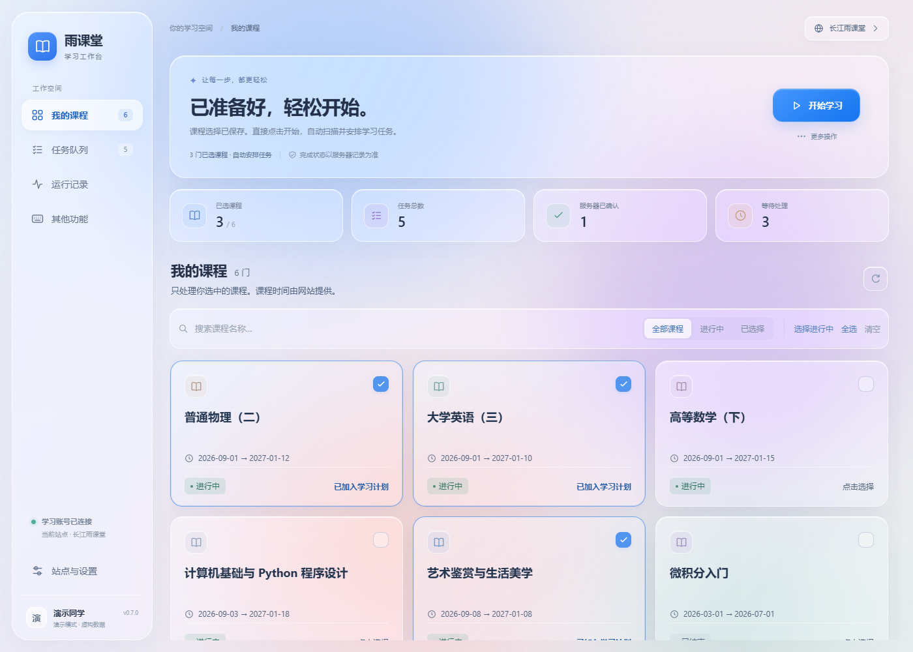
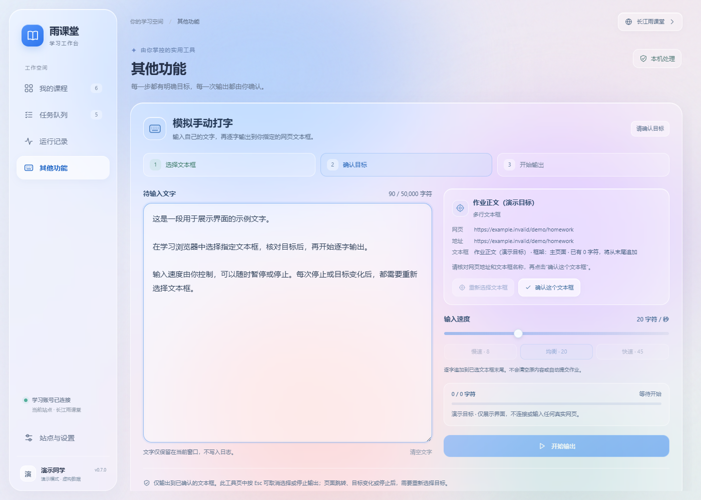

# 雨课堂智能任务管理助手 · RainClassroomBot

基于 **Python + Playwright + Microsoft Edge + pywebview / WebView2** 的 Windows 桌面任务管理工具。按开课时间选择课程，扫描未完成任务，通过网页正常操作处理已适配的视频、图文和 PPT，并复查服务器完成记录。

当前版本：**0.7.0**。需要 Windows 10/11 x64、Microsoft Edge 和 Microsoft Edge WebView2 Runtime。

日常操作只需 **选课程 → 点开始**。助手自动检查选课范围、扫描任务并继续执行；同一个主按钮负责开始、暂停和继续。

[下载 Windows 程序](https://github.com/ygstgddr/RainClassroomBot/releases/latest) · [更新记录](CHANGELOG.md) · [验证范围](VALIDATION.md) · [开发与打包](docs/DEVELOPMENT.md) · [反馈问题](https://github.com/ygstgddr/RainClassroomBot/issues)



本项目是独立工具，与雨课堂官方无隶属关系。不同学校和版本的页面、接口可能不同；输入某个站点地址不代表该站点所有任务均已适配。使用自己的账号，并遵守所在课程的学习要求。

## 功能介绍

| 功能 | 说明 |
|---|---|
| 通透玻璃桌面 | 彩色光团背景透过半透明卡片，CSS 背景模糊与高光描边形成玻璃层次；课程、任务、设置和记录使用统一风格 |
| 交互动画 | 页面淡入、按钮悬停与按压、课程勾选、菜单和设置弹层过渡；支持系统“减少动态效果”设置 |
| 一次开始 | 所选课程没有有效扫描结果时自动扫描；完整成功后继续执行，无需先后点击多个按钮 |
| 网站切换 | 顶栏入口选择或输入网址，支持主站、长江站及地址历史；不同站点独立保存登录和任务 |
| 持续登录 | 使用助手专用 Edge 用户目录；等待登录时持续检查状态，同一账号登录成功后衔接原操作 |
| 课程选择 | 显示开课、结课时间，支持逐门选择、搜索、选择进行中课程、全选和清空 |
| 清晰课程卡片 | 课程名称使用 18px 字号，日期与状态使用 12px；提高文字对比度，长名称完整换行，继续沿用半透明玻璃风格 |
| 其他功能 | 新增侧栏工具页，首个工具为“模拟手动打字”；选择并确认一个网页文本框后，逐字追加自己输入的文字 |
| 可控文字输出 | 默认每秒 20 字符，支持 1～60 调速、暂停、继续、停止和取消选择；显示已输出数量及预计剩余时间 |
| 扫描进度 | 显示扫描阶段、课程完成数、任务数、失败数和耗时，异常单独展示 |
| 详细任务类型 | 区分视频、图文、PPT、音频、直播、作业、考试、测验、讨论、课堂等 |
| 视频辅助 | 自动播放、恢复暂停、检测卡顿；从网站原生菜单选择最高倍速并核验实际速率 |
| 图文阅读 | 定位正文、滚动实际阅读区域、等待图片加载，点击明确的阅读确认按钮 |
| PPT 阅读 | 图片加载后默认每页停留约 5 秒，连续翻页；整份统一确认，漏记页补读 |
| 完成确认 | 重新读取服务器记录；播放结束或页面显示 100% 本身不等于任务完成 |
| 异常恢复 | 有限重试、保存队列、浏览器崩溃恢复、工作进程守护和重启频率限制 |
| 操作更直接 | 全部可自动处理的任务失败时，主按钮提供重试；守护停止时提供恢复连接，切站与关闭异步清理浏览器 |
| 减少重复工作 | 复用同一轮课程详情、去除相同状态的重复数据库提交；服务器查询与页面采样分开调度，慢网络时仍及时响应暂停 |
| 日志管理 | 桌面最近日志、扫描异常列表以及本地日志文件 |

**自动执行范围：**已适配且具有可靠进度数据的视频、图文、纯 PPT/课件。作业、考试、测验、签到、讨论，以及含答题或音视频页的课件需人工处理。程序不自动答题或提交作业，不构造学习心跳、伪造完成记录或跳转视频播放位置。

最高倍速来自播放器实际提供的菜单，不固定假设为 2 倍。速率重置或视频更换时重新检测。没有可用菜单时保持网站原速。

## 安装：直接运行 Windows 版本

1. 安装 Microsoft Edge，并确认已安装 **Microsoft Edge WebView2 Runtime**。若缺少运行时，从 [Microsoft 官方下载页](https://developer.microsoft.com/en-us/microsoft-edge/webview2/consumer/)安装 Evergreen WebView2 Runtime 后再打开助手。
2. 打开 [Releases](https://github.com/ygstgddr/RainClassroomBot/releases/latest)，下载 **RainClassroomBot-Windows-x64.zip**。
3. 完整解压到有写入权限的目录，例如 `D:\Apps\RainClassroomBot`。
4. 运行目录内的 `RainClassroomBot.exe`。此方式不需要安装 Python。

请保留 `_internal` 和 `config` 文件夹，不要单独移动 exe，也不要在压缩包内直接运行。GitHub 自动提供的 `Source code` 是源码，不是 Windows 程序。

桌面界面使用 WebView2 渲染本地界面，任务浏览器仍由 Playwright 启动专用 Edge。界面的 HTML、CSS 和 JavaScript 随程序打包，加载界面无需访问外部主题或 CDN。

发布页提供 `SHA256SUMS.txt`。可在 PowerShell 中计算下载包的校验值并与它比较：

```powershell
Get-FileHash .\RainClassroomBot-Windows-x64.zip -Algorithm SHA256
```

## 使用教程：选课程，再点开始

### 1. 选择站点并登录

首次打开助手会启动专用 Edge 并读取课程。使用其他雨课堂站点时，点击顶栏的网站入口，选择或输入实际使用的网址，再确认切换。例如：

- 主站：`https://www.yuketang.cn/v2/web`
- 长江雨课堂：`https://changjiang.yuketang.cn/web`

在助手打开的独立 Edge 窗口中扫码或使用账号登录。助手检测到登录成功后会继续读取课程，无需再点击刷新按钮。后续启动会复用这个目录的登录状态；助手不会自动读取你平时使用的 Edge 个人资料。

执行中登录过期时，助手等待重新登录；同一账号登录成功后继续原操作。若登录成另一个账号，助手会停下并要求重新确认课程，避免将旧账号的执行意图用于新账号。

### 2. 选择需要处理的课程

在侧栏“课程”中查看开课、结课时间，点击玻璃课程卡片选择目标课程；也可搜索课程、筛选进行中或已选课程，并批量选择进行中的课程。可以手动选择日期未知的课程，日期按北京时间显示。

启动时不会默认勾选全部旧课；**未选择课程就不会执行任务**。选课记录按站点和账号保存，未选课程的历史记录仍保留。更改选课范围后，下次开始会自动重新扫描。

### 3. 点击主按钮开始

选好课程后点击主按钮。助手自动完成“检查选课范围 → 必要时扫描 → 执行队列”，并显示当前步骤、扫描进度和任务状态。执行期间同一个按钮变为“暂停”；停止后可用它继续。暂停尚未完成时，先等待当前操作结束，再修改课程选择。

继续时优先恢复已确认的原队列；暂停期间改选了课程，则自动扫描新的选课范围。

任务仍串行执行，视频状态会显示实际倍率。侧栏“任务”查看队列，侧栏“记录”查看日志和扫描异常。默认只显示未完成或待确认任务；可切换筛选查看已完成任务。

如果扫描失败或只有部分课程扫描成功，自动流程会暂停并显示原因。修复问题后再次开始；空列表不能直接解释为所有课程均已完成。主动暂停扫描也会取消本轮自动执行意图，不会在后台悄悄开始任务。

通常无需手动扫描。需要刷新课程、重新扫描、重试失败任务、显示学习浏览器或打开日志文件夹时，使用“更多操作”菜单。任务行也可单独重试失败任务；当所选课程的自动任务均已失败且没有待执行任务时，主按钮会变为“重试失败任务”。

浏览器守护停止时，主按钮会显示“恢复连接”。恢复会重新连接当前站点并读取课程，原有选课和任务记录仍保留。切换网站或关闭助手时，会显示保存状态并退出受管理浏览器的进度，界面仍可响应。

只有服务器记录满足完成条件才记为“完成”。未获得可靠证据的任务保留失败或需适配状态，不会因为等待足够久而判定成功。

PPT 不再每翻一页就等待服务器回写。先跳过服务器已读页，再按每页约 5 秒浏览；浏览结束后等待批量记录，必要时补读未确认页。界面的“已浏览”和“服务器已读”含义不同，整份课件仍须服务器确认才会进入下一任务。

### 4. 其他功能：模拟手动打字

侧栏“其他功能”延续课程和任务页的半透明玻璃风格。它可以把你已经写好的文字逐字输入到指定网页编辑框，不会替你答题，也不会自动提交。

1. 在“模拟手动打字”的输入区填写自己的文字，支持中文、英文、空格和换行，每次最多 **50,000 字符**。
2. 如果正在扫描或执行学习任务，先点击“暂停学习”，等浏览器操作完全停止。使用可见的助手专用 Edge 打开目标网页；后台模式不能通过现场点击选择目标。
3. 点击“选择网页文本框”，在助手受管理的 Edge 中点击要输出的那个输入框。页面会提示正在选择；可取消选择，也可在网页选择期间按 Esc 取消。
4. 核对工具页显示的网页地址、框名称及类型，再点击“确认这个文本框”。**确认目标后仍不会输入文字**，只有点击“开始输出”才开始。
5. 调整速度后点击“开始输出”。默认每秒 20 字符，可在 1～60 之间调整；慢页面的实际速度可能低于所选值。文字追加到原框末尾，保留已有内容。
6. 可随时暂停、继续或停止。继续仍使用原来绑定的输入框；停止后须重新选择并确认。在本工具页按 Esc 也可取消选择或停止输出。输出结束后，请自行核对文字并在网站提交。

支持可编辑的普通单行输入框、多行文本框与 `contenteditable` 编辑区域；单行框不接受换行，密码、文件、只读和不可见框不支持。换行按文本输入处理，不通过 Enter 快捷键提交表单。

工具绑定的是你点击的**原始网页元素**，不使用系统全局键盘，也不会根据当前焦点随意寻找另一个框。焦点离开时自动暂停；目标被替换、页面导航或浏览器断开时停止并清除绑定，重新选择后才能再开始。打字期间也会锁定学习任务的开始和扫描，避免两者同时操作页面。

正文仅保留在界面与当前工作进程的内存，通过内存队列传递；不会保存到配置、SQLite 或日志。切站、关闭助手、停止或浏览器重启会取消输出并清除目标，重启不会自动重放旧文字。专用 Edge 的网页本身仍可能保存或向网站提交编辑内容。

暂停、停止会等待已在途的当前字符输入请求返回，防止留下仍在执行的输入操作。普通本地 Edge 页面已验证快速停止；如果网页脚本或浏览器响应很慢，这一步可能需要等待。实际测试范围见 [VALIDATION.md](VALIDATION.md)，本次未在真实作业中写入答案。



### 切换网站与退出

运行中切站会先保存状态并停止旧站工作进程，再打开新站；新站不会自动开始执行。首次访问新站只需登录、选择课程并点击开始。切回旧站可恢复原记录，需要的扫描由下次开始自动处理。

正常关闭助手会停止其工作进程和专用浏览器。电脑睡眠、断电或整个助手关闭期间不会继续运行；重新启动后从本地记录恢复。

## 任务状态说明

| 状态 | 含义 / 建议 |
|---|---|
| 待执行 / 执行中 | 已进入所选课程队列，等待或正在处理 |
| 完成 | 已取得服务器完成证据 |
| 人工处理 | 作业、考试或暂不支持自动处理的任务，请在网站操作 |
| 锁定 | 任务尚未开放或不满足访问条件 |
| 需适配 | 任务结构或进度数据不足，不能安全判断完成 |
| 失败 | 达到重试或确认时限，查看错误后再尝试 |

服务器缺少进度字段时显示“未知/需适配”，不会猜测成 0% 或 100%。课程章节是组织任务的容器，不额外伪造章节完成记录。

## 配置与数据位置

关闭助手后编辑 `config/config.yaml`，重启生效。常用配置如下：

| 配置项 | 默认值 | 用途 |
|---|---|---|
| `auto_max_video_speed` | `true` | 自动选择原生最高倍速；设为 `false` 可关闭 |
| `slides_page_seconds` | `5` | PPT 每页图片加载且可见后的停留秒数；范围 1～120，过短可能需要补读 |
| `headless` | `false` | 是否隐藏浏览器；首次登录和排错建议保持 `false` |
| `scan_concurrency` | `2` | 并发扫描课程数；执行学习任务仍为串行 |
| `poll_seconds` | `5` | 状态检查间隔，不是固定的任务完成等待时间 |
| `video_stall_seconds` | `90` | 视频无进展的恢复阈值 |
| `confirmation_timeout_seconds` | `180` | 页面结束后等待服务器确认的时限 |
| `task_timeout_seconds` | `21600` | 单任务最长处理时间（秒） |
| `max_task_attempts` | `3` | 单任务最大尝试次数 |
| `watchdog_timeout_seconds` | `120` | 工作进程无响应的恢复阈值 |
| `max_restarts_per_hour` | `5` | 每小时自动重启上限 |

主站默认保存于 `edge_profile/`、`data/`、`logs/`，其他站点保存于 `sites/<站点>/`。最近使用的网站保存于 `config/site.json`。

升级前关闭助手，备份 `config/`、`edge_profile/`、`data/`、`logs/` 和 `sites/`。解压新版到新目录，再按需迁移这些数据；配置新增项可参考新版默认配置。登录目录与数据库包含个人信息，**不要上传到公开仓库或反馈附件**。发行包不包含这些运行数据。

## 常见问题

**原来的多个按钮去哪了？** 开始、暂停和继续合并为一个主按钮，并随当前状态改变。刷新课程、重新扫描、重试与打开日志放在“更多”里，日常使用不必依次点击这些操作。

**新版打不开，提示 WebView2 或渲染器缺失？** 到 [Microsoft 官方下载页](https://developer.microsoft.com/en-us/microsoft-edge/webview2/consumer/)安装 Evergreen WebView2 Runtime，安装结束后重新启动助手。安装 Edge 浏览器本身不能替代确认 WebView2 Runtime 可用；详情见 [Microsoft 运行时分发说明](https://learn.microsoft.com/en-us/microsoft-edge/webview2/concepts/distribution)。

**动画不明显或想减少动画？** 界面会遵循系统“减少动态效果”偏好，此时保留操作反馈但缩短动画。玻璃透明度和背景模糊由本地 WebView2 渲染，课程卡片、列表、菜单和设置弹窗均采用同一套样式。

**开始后没有任务？** 先检查是否选择了课程，再查看扫描进度与“记录”中的异常。登录失效需在专用 Edge 中重新登录。旧版 HTTP 400 问题已修复；新站点仍可能需要适配，请提供脱敏后的错误和站点地址。

**最高倍速没有生效？** 使用 0.4.1 或更新版本，并确认配置开启。0.4.1 修复了 XT 播放器需要在选项内移动鼠标后点击的问题。以状态中读取的实际播放速率为准；播放器没有倍速菜单时不会强行修改速率。

**提示滑块，但浏览器里看不到？** 0.4.1 修复了将透明、屏幕外预加载验证 iframe 误认成可见验证框的问题。旧版提示属于检测误报，不能据此判断 Edge 出错。若新版仍误报，请记录版本和脱敏截图；确实可见的安全验证需要本人操作。

**视频结束了却没有标记完成？** 页面播放结束不保证服务器已记录。程序会复查记录，超时则保留失败原因。检查网络、课程开放条件及网站自身记录，不要反复提交任务来掩盖未知状态。

**有的 PPT、测试、课堂不能自动完成？** 当前只处理已适配的纯阅读课件。答题、作业、考试、签到、互动及含音视频的课件页需要人工处理。“课堂”也不必然等于 PPT。

**点击开始输出没有输入，或为什么必须先确认？** 先暂停学习任务，再在助手专用 Edge 中选择可编辑框，并核对目标后确认。工具不会输出到你平时浏览器里的随机焦点。页面跳转、原框被替换、停止或重启后，旧确认失效，需要重新选择。

**切换焦点后停了，或者停止稍慢？** 切换焦点会自动暂停，确认原框仍正确后可继续。为避免误输入和重复字符，暂停或停止会等当前已发出的字符请求返回；网页自身卡住时可能延迟。不要通过另一个框尝试接收尚未结束的输入。

**Edge 启动失败或用户目录被占用？** 不要同时运行两份助手共享同一登录目录。关闭助手及其专用 Edge 后重试；无需退出日常使用的 Edge 账号。

**能一直后台运行吗？** 默认使用可见 Edge，可配置无头模式，但网站可能对后台播放作限制。需要保持网络连接和电脑唤醒。程序提供恢复机制，目前没有连续数天运行的成功率保证。

## 从源码运行

建议使用 Python 3.12（当前验证版本为 3.12.10），先安装 Edge 与 WebView2 Runtime：

```powershell
git clone https://github.com/ygstgddr/RainClassroomBot.git
cd RainClassroomBot
py -3.12 -m venv .venv
.\.venv\Scripts\python.exe -m pip install -r requirements.txt
.\.venv\Scripts\python.exe main.py --self-check
.\.venv\Scripts\python.exe main.py
```

也可使用 `install.ps1` 安装 Python 依赖，再用 `start.cmd` 启动；WebView2 Runtime 由 Microsoft 官方安装器安装。默认桌面依赖 `pywebview==6.2.1`。程序通过 Playwright 的 `msedge` 通道启动已安装的 Edge，不需要额外下载 Chromium 或 WebDriver。

开发测试、模块说明与 exe 打包见 [开发指南](docs/DEVELOPMENT.md)。

## 已验证的范围

历史版本 0.4.2 的 73 项本地测试通过。该版本真实 PPT 的 11 个未读页约 58 秒浏览完，含加载和服务器确认总耗时约 106 秒，最终服务器记录为 20/20 页；冻结 exe 在本地模拟站通过视频、图文、PPT、服务器确认、Edge 崩溃恢复和正常退出检查。真实主站与长江站此前进行过有限的课程/任务扫描，真实 XT 播放器曾确认 2 倍速生效。

历史版本 0.5.0 的完整 108 项测试通过，覆盖当时界面的按钮交互、自动登录恢复、一次开始、暂停继续与换账号保护。0.6.0 改用 WebView2 桌面，本机已验证运行时可用。0.7.0 增加课程可读性调整与指定文本框打字工具，已在本地真实 Edge 页面验证目标绑定、输入和控制流程；未在真实作业中写入答案。本次界面、桥接和冻结程序的最终验收结果见 [VALIDATION.md](VALIDATION.md)。演示截图只使用虚构账号、课程和输入目标，不展示用户学习记录。

0.6.0 的本地效率对比使用真实 Edge 和模拟站点，每次模拟 GET 请求增加约 0.35 秒延迟，结果如下。这些数值反映本地调度优化，不能作为真实雨课堂的速度或完成率保证。

| 同一组本地模拟操作 | 0.5.0 | 0.6.0 优化实现 |
|---|---:|---:|
| 运行中请求暂停到响应 | 0.813 秒 | 0.109 秒 |
| 同一轮课程详情请求 | 2 次 | 1 次 |
| 100 次相同状态操作的数据库提交 | 100 次 | 0 次 |

优化保持 PPT 默认每页约 5 秒、按原生菜单选择最高视频倍速和最终服务器确认语义。减少重复请求与提交，不把本地浏览结束替代为服务器完成。

这些结果不代表所有学校版本、未完成视频/图文的实站计分或数天连续运行均已验收。完整说明见 [VALIDATION.md](VALIDATION.md)。

## 反馈与依赖

提交 Issue 时请说明程序版本、Windows/Edge 版本、站点地址、操作步骤、期望结果及脱敏后的错误。请勿提交 Cookie、令牌、账号资料、完整数据库或登录目录。

第三方组件说明见 [THIRD_PARTY_NOTICES.md](THIRD_PARTY_NOTICES.md)。Windows 发行包附带相应许可证文本。
