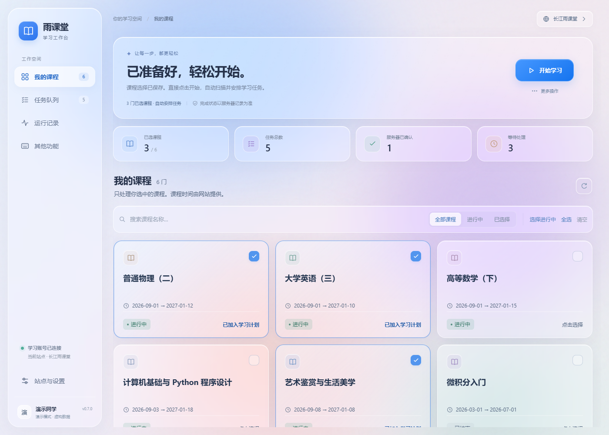
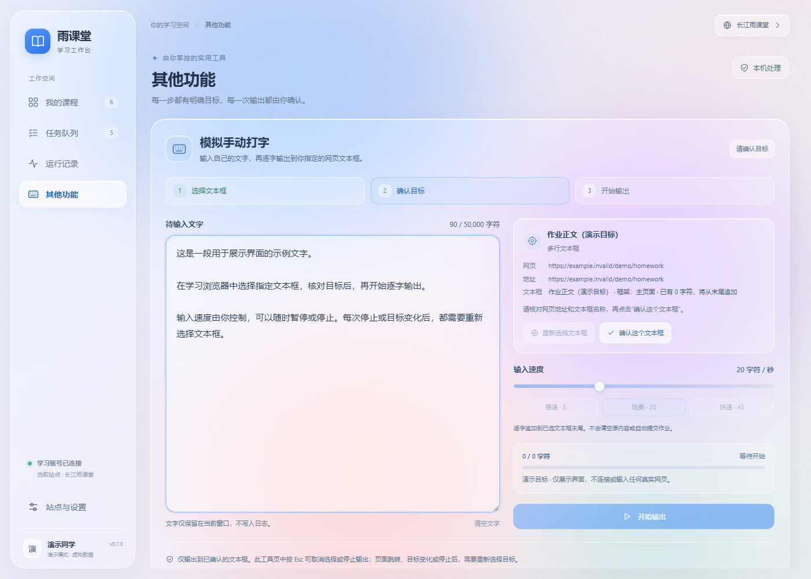

# 雨课堂智能任务管理助手 · RainClassroomBot

基于 **Python + Playwright + Microsoft Edge + pywebview / WebView2** 的 Windows 桌面任务管理工具。按开课时间选择课程，扫描未完成任务，通过网页正常操作处理已适配的视频、图文和 PPT，并复查服务器完成记录。

当前版本 **0.8.9**。需要 Windows 10/11 x64、Microsoft Edge 和 Microsoft Edge WebView2 Runtime。

启动先显示玻璃登录页，点击“登录”后在软件内打开学习浏览器，确认账号后自动进入课程页。内置浏览器默认静音。安装时运行发布页中的 `RainClassroomBot-0.8.9-Windows-x64-Setup.exe`，按提示选择目录即可，无需 Python 或管理员权限。

**旧版用户：**先正常退出助手，安装时选择原 `RainClassroomBot.exe` 所在文件夹，可继续使用原登录和任务数据。装到不同目录不会自动迁移账号。升级不覆盖已有配置，卸载也保留配置、登录与任务记录。详细说明见 [安装与升级](docs/INSTALLER.md)。

0.8.4 修复首次打开背景纯黑、失去焦点后玻璃背景变实色、窗口外围亮边及标题栏顶部细白线。优先使用 Accent Acrylic 保持前后台一致；该扩展接口不可用时回退到系统 Acrylic（失焦外观由系统决定）。关闭系统透明效果、高对比度及 `--opaque` 回退行为保留。

0.8.3 新增真正透出桌面背景的深色毛玻璃、低对比灰色描边与半透明按钮。原生 Acrylic 需要 Windows 11 22H2 或更新版本并开启系统“透明效果”；旧系统、高对比度或关闭透明效果时自动使用内置背景。可运行 `RainClassroomBot.exe --opaque` 手动回退；源码启动使用 `python main.py --opaque`。本次升级需要同时替换 exe 与 `_internal`，不能只更新 CSS。

0.8.2 修复同名章节、图文、视频导致任务入口无法唯一定位的问题，使用任务 ID 核对后点击对应标题。更新后重新扫描，可恢复因此暂停的队列。

日常操作只需 **选课程 → 点开始**。助手自动检查选课范围、扫描任务并继续执行；同一个主按钮负责开始、暂停和继续。

0.8.1 同时修复了“更多操作”菜单被统计卡片遮住、选项无法点击的问题，保持现有苹果玻璃风格。

0.8.1 修复部分课程的视频、图文没有初始进度记录时被误标为“需要适配”的问题。更新后重新扫描即可恢复这些任务；执行后的完成判定仍须取得服务器明确记录。日志和界面会显示本轮实际处理数量、确认数量和剩余状态，未执行任务时会明确说明。

**从 0.8.0 更新：**退出旧版并等待其管理的 Edge 关闭，将新版压缩包解压到临时文件夹，再把其中的 `RainClassroomBot.exe`、整个 `_internal` 文件夹、`VERSION.txt` 及说明文档复制到旧程序目录并覆盖同名文件。保留旧目录中的 `config`、`data`、`sites`、`edge_profile`，无需删除登录状态。重新打开软件后点击“更多 → 重新扫描”，或点“开始”自动更新所选课程任务。不能只替换 exe 而遗漏 `_internal`。

[下载 Windows 程序](https://github.com/ygstgddr/RainClassroomBot/releases/latest) · [更新记录](CHANGELOG.md) · [验证范围](VALIDATION.md) · [开发与打包](docs/DEVELOPMENT.md) · [反馈问题](https://github.com/ygstgddr/RainClassroomBot/issues)



本项目是独立工具，与雨课堂官方无隶属关系。不同学校和版本的页面、接口可能不同；输入某个站点地址不代表该站点所有任务均已适配。使用自己的账号，并遵守所在课程的学习要求。

0.8.7 支持连续多段输入复用锁定；任务列表按自动/手动分页，隐藏未开放作业，并可勾选任务按顺序执行。

## 功能介绍

| 功能 | 说明 |
|---|---|
| 软件内更新 | 站点与设置中检查 GitHub 正式版、阅读说明、下载及取消；校验通过后安装并退出，保留原目录的数据。任务或打字期间禁止安装；源码/演示模式不自动安装 |
| 通透玻璃桌面 | Windows 11 原生 Acrylic 模糊并透出后方桌面/窗口；正文保持完全不透明，卡片和按钮使用柔和灰边与半透明色底；不支持时回退到静态曲面背景 |
| 内置窗口标题栏 | 顶部 44px 玻璃标题栏，右上角从左到右为黄色最小化、绿色最大化/还原、红色关闭；空白区拖动、双击最大化，边缘及四角调整大小 |
| 雨课堂图标 | 使用官网原始图标，统一侧栏、标题栏、Windows 窗口、任务栏与 exe 图标；图片随程序提供 |
| 交互动画 | 页面淡入、按钮悬停与按压、课程勾选、菜单和设置弹层过渡；支持系统“减少动态效果”设置 |
| 一次开始 | 所选课程没有有效扫描结果时自动扫描；完整成功后继续执行，无需先后点击多个按钮 |
| 网站切换 | 顶栏入口选择或输入网址，支持主站、长江站及地址历史；不同站点独立保存登录和任务 |
| 学习浏览器 | 内置 WebView2 支持前进、返回、刷新、停止、主页和静音，显示网页加载及可识别的视频状态 |
| 自动答题（实验性） | 在浏览器打开 DeepSeek 控制台，扫描课程作业和测验，授权后处理已适配的题页并显示逐题回执 |
| 持续登录 | 各站点在自己的 `webview2_profile` 中保存登录，已有独立 Edge 会话仍可通过经典界面使用 |
| 主动登录入口 | 点击“登录”后才打开内置学习浏览器，可在登录前切换学校站点 |
| 课程选择 | 显示开课、结课时间，支持逐门选择、搜索、选择进行中课程、全选和清空 |
| 清晰课程卡片 | 课程名称使用 18px 字号，日期与状态使用 12px；提高文字对比度，长名称完整换行，继续沿用半透明玻璃风格 |
| 其他功能 | 新增侧栏工具页，首个工具为“模拟手动打字”；选择并确认一个网页文本框后，逐字追加自己输入的文字 |
| 可控文字输出 | 默认每秒 20 字符，支持 1～60 调速、暂停、继续、停止和取消选择；显示已输出数量及预计剩余时间 |
| 扫描进度 | 显示扫描阶段、课程完成数、任务数、失败数和耗时，异常单独展示 |
| 详细任务类型 | 区分视频、图文、PPT、音频、直播、作业、考试、测验、讨论、课堂等 |
| 视频辅助 | 默认静音、自动播放、恢复暂停、检测卡顿；从网站原生菜单选择最高倍速并核验实际速率 |
| 图文阅读 | 定位正文、滚动实际阅读区域、等待图片加载，点击明确的阅读确认按钮 |
| PPT 阅读 | 图片加载后默认每页停留约 5 秒，连续翻页；整份统一确认，漏记页补读 |
| 完成确认 | 重新读取服务器记录；播放结束或页面显示 100% 本身不等于任务完成 |
| 异常恢复 | 有限重试、保存队列、浏览器崩溃恢复、工作进程守护和重启频率限制 |
| 操作更直接 | 全部可自动处理的任务失败时，主按钮提供重试；守护停止时提供恢复连接，切站与关闭异步清理浏览器 |
| 减少重复工作 | 复用同一轮课程详情、去除相同状态的重复数据库提交；服务器查询与页面采样分开调度，慢网络时仍及时响应暂停 |
| 日志管理 | 桌面最近日志、扫描异常列表以及本地日志文件 |

常规学习队列自动处理已适配且具有可靠进度数据的视频、图文和纯 PPT/课件。签到、讨论以及含答题或音视频页的课件由使用者处理。作业和测验可在实验性控制台按任务授权执行，完整复核、填写通过后自动交卷并等待网页回执。学习进度以服务器记录为准。

最高倍速来自播放器实际提供的菜单，不固定假设为 2 倍。速率重置或视频更换时重新检测。没有可用菜单时保持网站原速。

## 安装 Windows 版本

1. 安装 Microsoft Edge，并确认已安装 **Microsoft Edge WebView2 Runtime**。若缺少运行时，从 [Microsoft 官方下载页](https://developer.microsoft.com/en-us/microsoft-edge/webview2/consumer/)安装 Evergreen WebView2 Runtime 后再打开助手。
2. 打开 [Releases](https://github.com/ygstgddr/RainClassroomBot/releases/latest)，下载 `RainClassroomBot-0.8.9-Windows-x64-Setup.exe`。
3. 双击安装包。已有版本请选择原安装目录。安装后从开始菜单启动雨课堂助手。

发布页提供 `SHA256SUMS-0.8.9.txt`。可在 PowerShell 中计算下载包的校验值并比对。

```powershell
Get-FileHash .\RainClassroomBot-0.8.9-Windows-x64-Setup.exe -Algorithm SHA256
```

## 自动答题（实验性）

1. 登录后进入「浏览器」，点击工具栏的「自动答题（实验性）」。首次使用需要填写 DeepSeek API Key，保存后由 Windows DPAPI 加密存放在本机。
2. 在「任务待办」里点击「扫描任务」，再选择一项点击「交给 Agent」。此操作授权本次任务的开始计时、复核填写与提交；已打开题页时可点击「完整执行当前题页」。普通聊天和「读网页」仍只读取，不会自动交卷。
3. 可读题干、选项和共享材料会发送到 DeepSeek。两轮复核一致后填写，再重新检查页面上的全部答案，点击提交并处理明确的确认弹窗。回执区区分已填写、已确认提交、未提交和提交结果待确认。两轮一致不代表保证答案正确。
4. 当前适配单页可读的单选、多选及短文本。缺图、乱码、未适配控件或未完整读取的分页任务会停下；提交后跳转或超时无明确回执时不会重复交卷，请重新扫描确认。
5. 回复可以直接选中复制，也可点击「复制回复」。推理强度使用快速、低、高、最大四档滑杆，支持方向键、Home/End 和 Esc；档位对应模型已有参数，不额外增加虚构档位。

Agent 通过现有 Playwright/CDP 连接操控同一个 WebView2，不另启一套浏览器，也不安装外部插件服务。内置工具包括网页观察、带引用的点击、滚动、题目读取与分组、复核填写、争议裁决及核对提交。普通聊天只有读取工具；点击完整执行或交给 Agent 后，才授予本次任务的操作权限。

工具会报告控件遮挡、页面跳转、写入结果和网站回执。页面内展开/收起保留题目上下文，跳转到同一考试的 start/exam 路由后重新读取，cover 成绩页可识别已交卷标识与得分；失败可在本轮内最多修复填写三次。同一题页的复核结论会缓存，不能靠重试消除争议。两轮复核不一致时，Agent 可以引用原文，交给 DeepSeek V4 Pro 额外裁决（可能产生额外 API 用量）。有无法解决的问题时 Agent 可以主动暂停，自动收尾不会覆盖这个决定。

开发版实测范围：真实站点的一份 5 题单选阅读练习已完成填写和提交，网站得分 3/5、未作答 0 题。自动操作已得到真实验证，答案正确率仍需提升；真实填空题、跨页题组及其他复杂布局尚未完成验收。

## 使用教程：选课程，再点开始

### 1. 选择站点并登录

打开助手后先显示登录页。确认站点后点击“登录”，在软件内完成登录。使用其他雨课堂站点时，点击登录页右上角的网站入口，选择或输入实际使用的网址。例如：

- 主站：`https://www.yuketang.cn/v2/web`
- 长江雨课堂：`https://changjiang.yuketang.cn/web`

首次使用内置浏览器时，请按站点提示扫码或登录。登录有效时，再次点击“登录”会复用该站点的内置浏览器会话。切换站点后再次点击登录连接对应网站，任务、选课和旧版 Edge 登录资料继续存放在原目录。

侧栏「浏览器」在「其他功能」上方。工具栏可控制网页并显示播放时间和倍速。学习任务占用网页时，可在浏览器页暂停当前操作后继续手动浏览。登录后先读取课程，点击“开始学习”才执行队列。

执行中登录过期时，助手等待重新登录；同一账号登录成功后继续原操作。若登录成另一个账号，助手会停下并要求重新确认课程，避免将旧账号的执行意图用于新账号。

### 2. 选择需要处理的课程

在侧栏“课程”中查看开课、结课时间，点击玻璃课程卡片选择目标课程；也可搜索课程、筛选进行中或已选课程，并批量选择进行中的课程。可以手动选择日期未知的课程，日期按北京时间显示。

启动时不会默认勾选全部旧课；**未选择课程就不会执行任务**。选课记录按站点和账号保存，未选课程的历史记录仍保留。更改选课范围后，下次开始会自动重新扫描。

### 3. 点击主按钮开始

选好课程后点击主按钮。助手自动完成“检查选课范围 → 必要时扫描 → 执行队列”，并显示当前步骤、扫描进度和任务状态。执行期间同一个按钮变为“暂停”；停止后可用它继续。暂停尚未完成时，先等待当前操作结束，再修改课程选择。

继续时优先恢复已确认的原队列；暂停期间改选了课程，则自动扫描新的选课范围。

任务仍串行执行，视频状态会显示实际倍率。侧栏“任务”查看队列，侧栏“记录”查看日志和扫描异常。默认只显示未完成或待确认任务；可切换筛选查看已完成任务。

如果扫描失败或只有部分课程扫描成功，自动流程会暂停并显示原因。修复问题后再次开始；空列表不能直接解释为所有课程均已完成。主动暂停扫描也会取消本轮自动执行意图，不会在后台悄悄开始任务。

通常无需手动扫描。需要刷新课程、重新扫描、重试失败任务、显示学习浏览器或打开日志文件夹时，使用“更多操作”菜单。任务行也可单独重试失败任务；当所选课程的自动任务均已失败且没有待执行任务时，主按钮会变为“重试失败任务”。

浏览器守护停止时，主按钮会显示“恢复连接”。恢复会重新连接当前站点并读取课程，原有选课和任务记录仍保留。切换网站或关闭助手时，会显示保存状态并退出受管理浏览器的进度，界面仍可响应。

只有服务器记录满足完成条件才记为“完成”。未获得可靠证据的任务保留失败或需适配状态，不会因为等待足够久而判定成功。

PPT 不再每翻一页就等待服务器回写。先跳过服务器已读页，再按每页约 5 秒浏览；浏览结束后等待批量记录，必要时补读未确认页。界面的“已浏览”和“服务器已读”含义不同，整份课件仍须服务器确认才会进入下一任务。

### 4. 其他功能：模拟手动打字

侧栏“其他功能”延续课程和任务页的半透明玻璃风格。它可以把你已经写好的文字逐字输入到指定网页编辑框，不会替你答题，也不会自动提交。

1. 在「其他功能」点击「打开打字窗口」，或在浏览器工具栏点击「打字控制」。把独立窗口拖到方便的位置，在里面填写自己的文字，每次最多 **50,000 字符**。
2. 在主窗口的浏览器打开目标网页。若学习任务正在运行，可在打字窗口点击「暂停学习」，等待当前浏览器操作停止。
3. 在打字窗口点击「选择网页文本框」，然后在主窗口的浏览器点击目标。可在打字窗口取消，也可以在网页上按 Esc 取消。
4. 核对打字窗口显示的网页地址、框名称及类型，再点击「确认这个文本框」。点击「开始输入」后，文字才会送到该输入框。
5. 调整速度后点击“开始输出”。默认每秒 20 字符，可在 1～60 之间调整；慢页面的实际速度可能低于所选值。文字追加到原框末尾，保留已有内容。
6. 可随时暂停、继续或停止。继续仍使用原来绑定的输入框；停止后须重新选择并确认。在本工具页按 Esc 也可取消选择或停止输出。输出结束后，请自行核对文字并在网站提交。

支持可编辑的普通单行输入框、多行文本框与 `contenteditable` 编辑区域；单行框不接受换行，密码、文件、只读和不可见框不支持。换行按文本输入处理，不通过 Enter 快捷键提交表单。

工具绑定的是你点击的**原始网页元素**，不使用系统全局键盘，也不会根据当前焦点随意寻找另一个框。焦点离开时自动暂停；目标被替换、页面导航或浏览器断开时停止并清除绑定，重新选择后才能再开始。打字期间也会锁定学习任务的开始和扫描，避免两者同时操作页面。

正文仅保留在打字窗口与当前工作进程的内存，通过内存队列传递。关闭打字窗口会停止输出、释放输入框并清除窗口内的原文，主窗口继续运行。切站、关闭助手或浏览器重启也会清除目标。网页本身可能保存用户已经输入的内容。

暂停、停止会等待已在途的当前字符输入请求返回，防止留下仍在执行的输入操作。普通本地 Edge 页面已验证快速停止；如果网页脚本或浏览器响应很慢，这一步可能需要等待。实际测试范围见 [VALIDATION.md](VALIDATION.md)，本次未在真实作业中写入答案。



### 顶部窗口控制、切换网站与退出

窗口操作集中在**软件内容区顶部的玻璃标题栏**，右上角三个圆形按钮从左到右分别对应：

- **黄色：最小化。** 只把工作台收起到任务栏，当前学习任务继续执行；最小化不等于暂停。需要暂停学习时仍使用页面中的主按钮。
- **绿色：最大化 / 还原。** 扩大窗口以显示更多内容，再次点击回到原窗口大小。
- **红色：关闭助手。** 先停止当前输入与工作进程，保存已有任务状态并退出受管理 Edge，清理完成后关闭窗口。

拖动标题栏的空白区域可以移动窗口，双击该区域可切换最大化和还原。窗口未最大化时，拖动四边或四角可调整大小；调整过程中保留界面最小尺寸。按钮、输入框和课程卡片仍按各自用途操作。

运行中切站会先保存状态并停止旧站工作进程，再打开新站；新站不会自动开始执行。首次访问新站只需登录、选择课程并点击开始。切回旧站可恢复原记录，需要的扫描由下次开始自动处理。

正常关闭助手会停止其工作进程和专用浏览器。电脑睡眠、断电或整个助手关闭期间不会继续运行；重新启动后从本地记录恢复。

## 任务状态说明

| 状态 | 含义 / 建议 |
|---|---|
| 待执行 / 执行中 | 已进入所选课程队列，等待或正在处理 |
| 完成 | 已取得服务器完成证据 |
| 人工处理 | 作业、考试或暂不支持自动处理的任务，请在网站操作 |
| 锁定 | 任务尚未开放或不满足访问条件 |
| 需适配 | 任务结构或进度数据不足，不能安全判断完成 |
| 失败 | 达到重试或确认时限，查看错误后再尝试 |

服务器缺少进度字段时显示“未知/需适配”，不会猜测成 0% 或 100%。课程章节是组织任务的容器，不额外伪造章节完成记录。

## 配置与数据位置

关闭助手后编辑 `config/config.yaml`，重启生效。常用配置如下：

| 配置项 | 默认值 | 用途 |
|---|---|---|
| `auto_max_video_speed` | `true` | 自动选择原生最高倍速；设为 `false` 可关闭 |
| `slides_page_seconds` | `5` | PPT 每页图片加载且可见后的停留秒数；范围 1～120，过短可能需要补读 |
| `headless` | `false` | 是否隐藏浏览器；首次登录和排错建议保持 `false` |
| `scan_concurrency` | `2` | 并发扫描课程数；执行学习任务仍为串行 |
| `poll_seconds` | `5` | 状态检查间隔，不是固定的任务完成等待时间 |
| `video_stall_seconds` | `90` | 视频无进展的恢复阈值 |
| `confirmation_timeout_seconds` | `180` | 页面结束后等待服务器确认的时限 |
| `task_timeout_seconds` | `21600` | 单任务最长处理时间（秒） |
| `max_task_attempts` | `3` | 单任务最大尝试次数 |
| `watchdog_timeout_seconds` | `120` | 工作进程无响应的恢复阈值 |
| `max_restarts_per_hour` | `5` | 每小时自动重启上限 |

主站默认保存于 `edge_profile/`、`data/`、`logs/`，其他站点保存于 `sites/<站点>/`。最近使用的网站保存于 `config/site.json`。

升级前关闭助手，备份 `config/`、`edge_profile/`、`data/`、`logs/` 和 `sites/`。解压新版到新目录，再按需迁移这些数据；配置新增项可参考新版默认配置。登录目录与数据库包含个人信息，**不要上传到公开仓库或反馈附件**。发行包不包含这些运行数据。

## 常见问题

**原来的多个按钮去哪了？** 开始、暂停和继续合并为一个主按钮，并随当前状态改变。刷新课程、重新扫描、重试与打开日志放在“更多”里，日常使用不必依次点击这些操作。

**新版打不开，提示 WebView2 或渲染器缺失？** 到 [Microsoft 官方下载页](https://developer.microsoft.com/en-us/microsoft-edge/webview2/consumer/)安装 Evergreen WebView2 Runtime，安装结束后重新启动助手。安装 Edge 浏览器本身不能替代确认 WebView2 Runtime 可用；详情见 [Microsoft 运行时分发说明](https://learn.microsoft.com/en-us/microsoft-edge/webview2/concepts/distribution)。

**动画不明显或想减少动画？** 界面会遵循系统“减少动态效果”偏好，此时保留操作反馈但缩短动画。玻璃透明度和背景模糊由本地 WebView2 渲染，课程卡片、列表、菜单和设置弹窗均采用同一套样式。

**开始后没有任务？** 先检查是否选择了课程，再查看扫描进度与“记录”中的异常。登录失效需在专用 Edge 中重新登录。旧版 HTTP 400 问题已修复；新站点仍可能需要适配，请提供脱敏后的错误和站点地址。

**最高倍速没有生效？** 使用 0.4.1 或更新版本，并确认配置开启。0.4.1 修复了 XT 播放器需要在选项内移动鼠标后点击的问题。以状态中读取的实际播放速率为准；播放器没有倍速菜单时不会强行修改速率。

**提示滑块，但浏览器里看不到？** 0.4.1 修复了将透明、屏幕外预加载验证 iframe 误认成可见验证框的问题。旧版提示属于检测误报，不能据此判断 Edge 出错。若新版仍误报，请记录版本和脱敏截图；确实可见的安全验证需要本人操作。

**视频结束了却没有标记完成？** 页面播放结束不保证服务器已记录。程序会复查记录，超时则保留失败原因。检查网络、课程开放条件及网站自身记录，不要反复提交任务来掩盖未知状态。

**有的 PPT、测试、课堂不能自动完成？** 当前只处理已适配的纯阅读课件。答题、作业、考试、签到、互动及含音视频的课件页需要人工处理。“课堂”也不必然等于 PPT。

**点击开始输出没有输入，或为什么必须先确认？** 先暂停学习任务，再在助手专用 Edge 中选择可编辑框，并核对目标后确认。工具不会输出到你平时浏览器里的随机焦点。页面跳转、原框被替换、停止或重启后，旧确认失效，需要重新选择。

**切换焦点后停了，或者停止稍慢？** 切换焦点会自动暂停，确认原框仍正确后可继续。为避免误输入和重复字符，暂停或停止会等当前已发出的字符请求返回；网页自身卡住时可能延迟。不要通过另一个框尝试接收尚未结束的输入。

**Edge 启动失败或用户目录被占用？** 不要同时运行两份助手共享同一登录目录。关闭助手及其专用 Edge 后重试；无需退出日常使用的 Edge 账号。

**能一直后台运行吗？** 默认使用可见 Edge，可配置无头模式，但网站可能对后台播放作限制。需要保持网络连接和电脑唤醒。程序提供恢复机制，目前没有连续数天运行的成功率保证。

## 从源码运行

建议使用 Python 3.12（当前验证版本为 3.12.10），先安装 Edge 与 WebView2 Runtime：

```powershell
git clone https://github.com/ygstgddr/RainClassroomBot.git
cd RainClassroomBot
py -3.12 -m venv .venv
.\.venv\Scripts\python.exe -m pip install -r requirements.txt
.\.venv\Scripts\python.exe main.py --self-check
.\.venv\Scripts\python.exe main.py
```

也可使用 `install.ps1` 安装 Python 依赖，再用 `start.cmd` 启动；WebView2 Runtime 由 Microsoft 官方安装器安装。默认桌面依赖 `pywebview==6.2.1`。程序通过 Playwright 的 `msedge` 通道启动已安装的 Edge，不需要额外下载 Chromium 或 WebDriver。

开发测试、模块说明与 exe 打包见 [开发指南](docs/DEVELOPMENT.md)。

## 已验证的范围

历史版本 0.4.2 的 73 项本地测试通过。该版本真实 PPT 的 11 个未读页约 58 秒浏览完，含加载和服务器确认总耗时约 106 秒，最终服务器记录为 20/20 页；冻结 exe 在本地模拟站通过视频、图文、PPT、服务器确认、Edge 崩溃恢复和正常退出检查。真实主站与长江站此前进行过有限的课程/任务扫描，真实 XT 播放器曾确认 2 倍速生效。

历史版本 0.5.0 的完整 108 项测试通过，覆盖当时界面的按钮交互、自动登录恢复、一次开始、暂停继续与换账号保护。0.6.0 改用 WebView2 桌面，本机已验证运行时可用。0.7.0 增加课程可读性调整与指定文本框打字工具，已在本地真实 Edge 页面验证目标绑定、输入和控制流程；未在真实作业中写入答案。0.8.0 在同一工作台内增加玻璃标题栏与统一图标，窗口控制、桥接和冻结程序的最终验收结果见 [VALIDATION.md](VALIDATION.md)。演示截图只使用虚构账号、课程和输入目标，不展示用户学习记录。

0.6.0 的本地效率对比使用真实 Edge 和模拟站点，每次模拟 GET 请求增加约 0.35 秒延迟，结果如下。这些数值反映本地调度优化，不能作为真实雨课堂的速度或完成率保证。

| 同一组本地模拟操作 | 0.5.0 | 0.6.0 优化实现 |
|---|---:|---:|
| 运行中请求暂停到响应 | 0.813 秒 | 0.109 秒 |
| 同一轮课程详情请求 | 2 次 | 1 次 |
| 100 次相同状态操作的数据库提交 | 100 次 | 0 次 |

优化保持 PPT 默认每页约 5 秒、按原生菜单选择最高视频倍速和最终服务器确认语义。减少重复请求与提交，不把本地浏览结束替代为服务器完成。

这些结果不代表所有学校版本、未完成视频/图文的实站计分或数天连续运行均已验收。完整说明见 [VALIDATION.md](VALIDATION.md)。

## 反馈与依赖

提交 Issue 时请说明程序版本、Windows/Edge 版本、站点地址、操作步骤、期望结果及脱敏后的错误。请勿提交 Cookie、令牌、账号资料、完整数据库或登录目录。

第三方组件说明见 [THIRD_PARTY_NOTICES.md](THIRD_PARTY_NOTICES.md)。Windows 发行包附带相应许可证文本。

图标取自雨课堂官网原始 favicon，标识归原权利人所有；本助手仍为独立项目。原始地址、文件校验值与 ICO 格式转换说明见 [图标来源](https://github.com/ygstgddr/RainClassroomBot/blob/main/gui/assets/ICON_SOURCE.md)。

## 指定任务与连续输入（0.8.7）

任务列表提供“可自动完成”和“需手动完成”两页；未开放作业暂时隐藏，重新扫描确认开放后会显示。待适配的视频和课件归入手动页。

在自动页勾选目标任务，再点“执行所选任务”，按勾选顺序处理；任务左侧序号表示执行顺序。也可点某项的“单独执行”。“选择当前列表”仅选择符合当前搜索/类型筛选且可执行的项目。暂停后点击继续仍使用本轮范围；若任务被删除、未开放或需要适配，程序暂停并提示重新选择，不会扩大到其他任务。普通“开始学习”在空闲状态仍执行所选课程的全部可自动任务。

模拟打字只需首次选择并确认网页输入框。每段完成后保留锁定，修改原文并点“输入下一段”即可继续追加；点“解除锁定”释放目标。换网页、切换任务导致导航或输入框被替换后，需要重新选择。程序不会将相同名称的新框当成原框，也不会自动提交。
